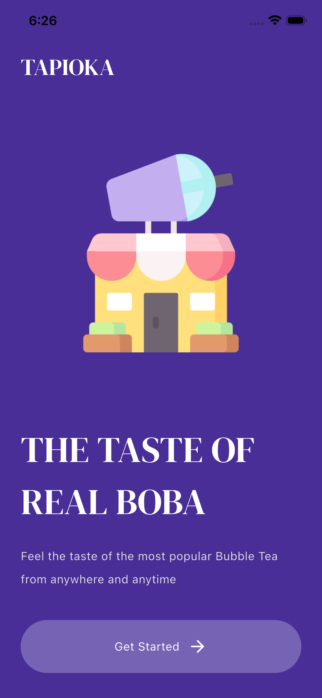
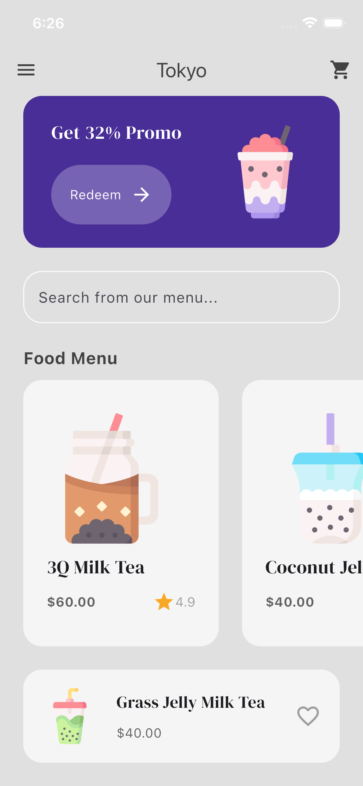
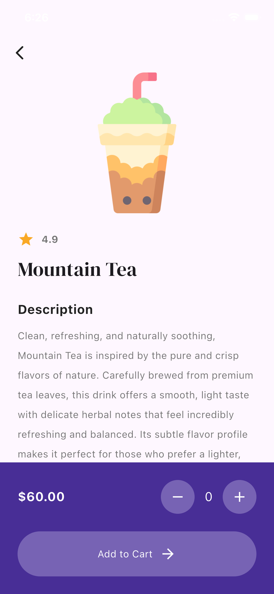
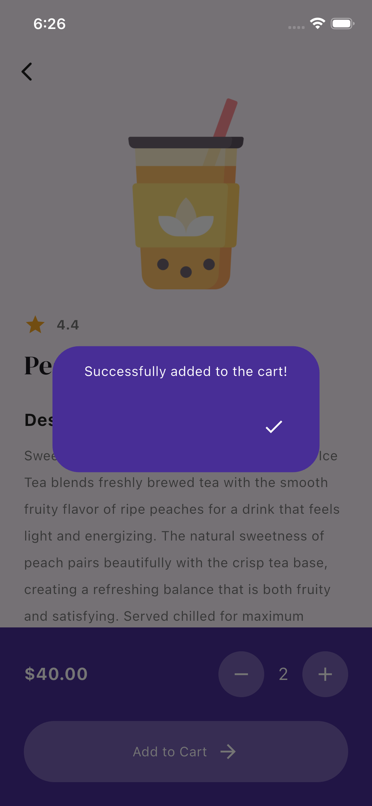
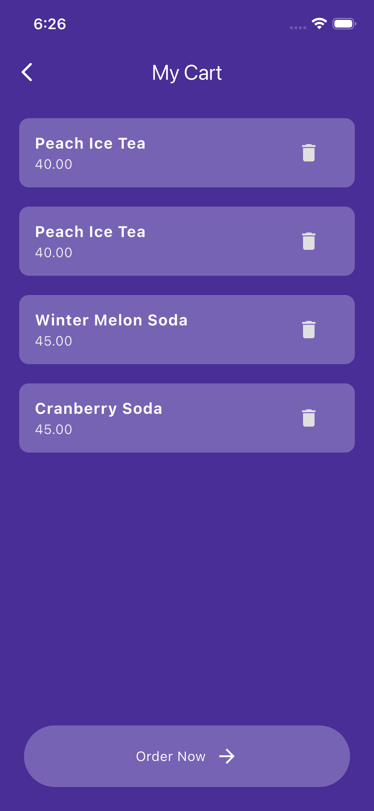
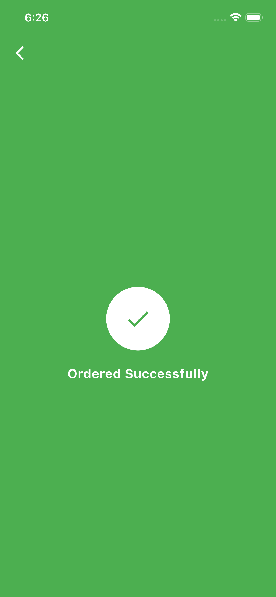

# TAPIOKA

Tapioka is a bubble tea shop app made in Flutter. It's a simple app with a home screen, a menu page and a functional cart. 
This is my first app in flutter and took a lot time and effort since I had never coded in Flutter/Dart before. I made this app as a get-familiar-with-flutter project so that I can start building another big project which is (surprise surprise) an app made with Flutter called 'Stopify'.
I found flutter quite confusing at first. Took some time to get the hang of it. I can see now why people call it similar to working with html/css divs.

P.S still looking for a good formatter for flutter. lmk if you know any good ones.

> Note: this project is heavily based on a youtube tutorial. more details in Credits section.

## Features
- intro page
- main menu page
    - navbar (sort of) with cart page icon
    - horizontal scrolling menu items
    - search bar (not working, just a text field)
    - popular liked items
- food details page:
    - add to cart button
    - quantity count widget
    - adding to cart produces a success message and takes back to main menu page instead of food deatils page
- cart page:
    - delete items from cart
    - order now button (takes to order page)
- order page:
    - order successful message displayed

## DEMO VIDEO:

https://github.com/user-attachments/assets/b8a9d25b-6483-480f-a144-17c5ea0a0a8f

## Screenshots

intro page

main menu page

food details page

add to cart success popup

cart page

order successful page [made and implemented by myself]

## Run Locally

#### If you have flutter and xcode installed
1. clone the repo
2. open iOS emulator
3. run `flutter run` from the root directory

#### For android testing
1. download the release on either an actual phone or an emulator
2. install the app
3. click on the app icon after installing

## Credits
- made by me
- project based heavily on (used as a tutorial to learn flutter dev): [Mitch Koko - Youtube](https://youtu.be/zOQzu3BGSqo?si=ljsUHhivh3Ma7kxG)
- link to icon pack: [bubble tea icon pack - flaticon](https://www.flaticon.com/packs/bubble-tea-1?word=bubble%20tea)

> AI Usage:
- Gemini AI: to help explain flutter concepts/code chunks found online
- ChatGPT: generated item descriptions for food_details_page
- Some random image of cafe menu on my sister's phone: giving menu item names to the downloaded icon pack images
